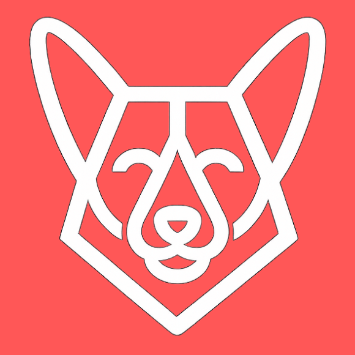
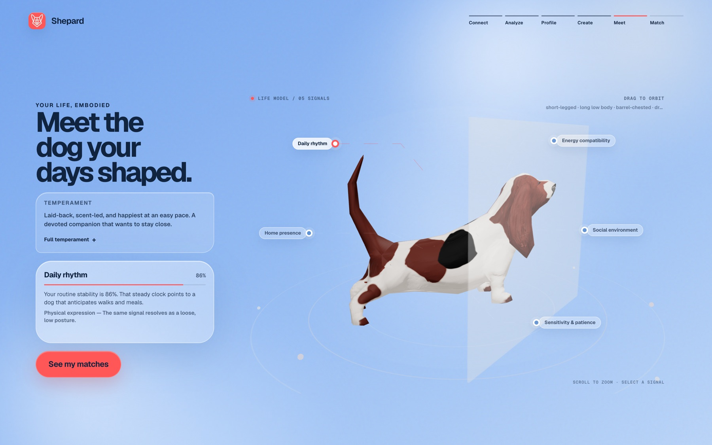
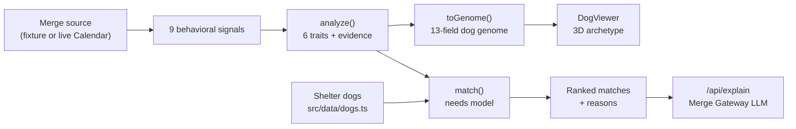
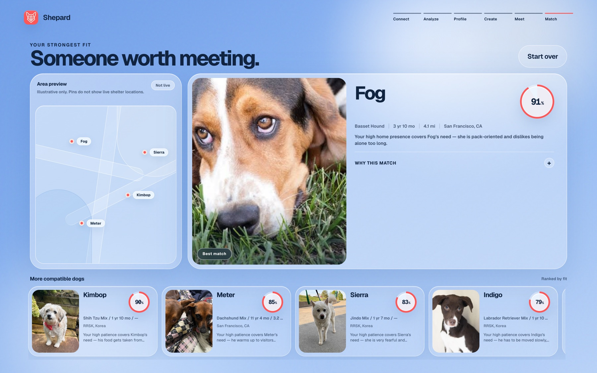

<p align="center">
  
</p>

<h1 align="center">Shepard</h1>

<p align="center">
  <em>Match people with shelter dogs by what the dog needs, read from how the person actually spends their week.</em>
</p>

<p align="center">
  <a href="https://shepard-nine.vercel.app"></a>
  <a href="LICENSE"></a>
  
  
  
  
  
</p>

<p align="center">
  <b><a href="https://shepard-nine.vercel.app">Live demo</a></b> ·
  <b><a href="https://youtu.be/-Jq7HaZ3RPo">Video</a></b>
</p>

---

**Shepard** is a dog-adoption matcher for people who want a dog that fits the life they already have. It reads **behavioral metadata** from connected accounts (meeting density, free blocks, weekend load, after-hours activity), turns it into a six-trait **personality profile**, renders a **3D archetype dog** from that profile, and ranks real shelter dogs with an **asymmetric needs model**: the question is not "does this dog look like what you want?" but "can you consistently give this dog what it needs?"

This is a working demo. The main flow at `/` runs on five fixture personas and ten dogs (five real dogs from RRSK kennel cards in Korea, five synthetic San Francisco dogs). A separate page at `/merge-demo` connects a real Google Calendar through Merge.

<p align="center">
  
</p>

## Demo

<p align="center">
  <a href="https://youtu.be/-Jq7HaZ3RPo">
    
  </a>
  <br>
  <sub>Demo video, click to watch on YouTube.</sub>
</p>

## Features

- **Behavior over self-report**: nine signals from Calendar, Slack and Drive (`src/lib/analyze.ts`) map to six traits by fixed weighted sums, and every trait carries the evidence strings that produced it.
- **Deterministic dog genome**: `toGenome` maps the profile to 11 numeric shape parameters plus coat and accent color, with no randomness, so the same profile always yields the same dog.
- **Interactive 3D companion**: React Three Fiber renders the genome on a low-poly dog model you can orbit and zoom.
- **Needs-based matching**: each dog has six need values (patience, routine, home presence, activity, noise tolerance, dog experience). Shortfall is penalized harder than surplus, and home presence carries the largest weight (0.30).
- **Explained results**: each match lists its strongest fits and its biggest gaps, with dog-specific notes taken from the kennel card, plus a short LLM explanation through Merge Gateway that falls back to a fixed sentence if no key is set.
- **Isolated live Calendar lab**: `/merge-demo` signs in with Google, links Calendar through a Merge Agent Handler tool pack, and returns only aggregate timing signals.

## How it works



1. **Connect**: the user picks sources. Google Calendar, Google Drive and Slack are enabled; Gmail, Notion, Dropbox, Salesforce, HubSpot, Jira and Microsoft Teams are shown but disabled.
2. **Analyze**: `/api/profile` returns raw signals. The default source is a fixture persona; `DATA_SOURCE=live` pulls 30 days of Calendar events and falls back to the fixture on any error.
3. **Profile**: `analyze()` produces activity level, home presence, routine stability, household noise, patience and social density, each in 0 to 1 with evidence.
4. **Generate**: `toGenome()` sets body, leg, head, ear, snout and tail proportions, fluffiness, posture and coat color from those traits.
5. **Match**: `match()` scores every dog on its six needs, maps the score into 8 to 99.9, and builds up to three reasons per dog.
6. **Meet nearby**: matches show photos, breed, character notes from the kennel card, location and the LLM explanation.

<p align="center">
  
  <br>
  <sub>Match screen for the <code>homebody</code> fixture persona on the live demo.</sub>
</p>

All scoring is computed once, synchronously, as soon as the raw data exists (`computeAll` in `src/lib/flow.ts`). The analyzing and generating screens are timed reveals over results that are already done (12 s and 14 s). The penalty slopes in `src/lib/match.ts` were tuned so the five fixture personas land on five different dogs; they are not fitted to adoption outcomes.

## Live Calendar integration

`/merge-demo` is kept separate so the fixture-backed flow at `/` stays reliable. It needs Google OAuth plus a Merge Agent Handler tool pack containing the `google-calendar` connector and its read-only `list_events` tool.

Each signed-in person gets a pseudonymous, isolated Merge Registered User, derived from their Google ID with `MERGE_USER_ID_SECRET`. The browser receives a short-lived, single-use Link token plus an encrypted, HttpOnly, user-bound handle used for profile and deletion requests. The server reads a bounded 30-day window, reduces events to aggregate timing signals right away, and returns no event titles, descriptions, locations, attendee identities, plaintext Merge user IDs or MCP URLs. Slack and Drive signals on that page are labeled as samples.

The included rate limiter is per process. A public deployment also needs a distributed edge or platform rate limit, and one full smoke test (Google sign-in, Calendar Link, aggregate profile, account deletion) after installing secrets.

## Tech stack

| Layer | Technology |
|---|---|
| Frontend | Next.js 16 (App Router), React 19, TypeScript 5, Tailwind CSS 4, Motion |
| 3D | Three.js 0.185, React Three Fiber, drei |
| Integrations | Merge Agent Handler (MCP), `@mergeapi/react-agent-handler-link`, NextAuth 4 with Google OAuth |
| Explanations | Merge Gateway (OpenAI-compatible chat completions) |
| Tests | Vitest |

## Project structure

```
.
├── src/
│   ├── app/             routes: / flow, /merge-demo, /dev harness, /api/*
│   ├── components/      flow shell, 3D DogViewer, one component per screen
│   ├── lib/             analyze, genome, match, gateway, Merge sources, merge-demo security
│   ├── data/            shelter dogs and fixture personas
│   └── types/           shared types
├── public/
│   ├── dogs/            dog photos, named by dog id
│   └── models/          low-poly dog glTF model and textures
└── docs/                README screenshots, Merge demo spec and plan
```

## Getting started

**Requirements:** Node.js 20+ and npm.

```bash
git clone https://github.com/unio207/dog_matcher.git
cd dog_matcher
npm install
cp .env.example .env.local
npm run dev
```

Open [http://localhost:3000](http://localhost:3000). With an empty `.env.local` the main flow runs on fixtures and the fixed fallback explanation.

`.env.local` takes these variables (see `.env.example` for what each one does):

```bash
DATA_SOURCE=                    # "fixture" (default) or "live"
FIXTURE_PERSONA=
MERGE_AGENT_HANDLER_KEY=
MERGE_TOOL_PACK_ID=
MERGE_REGISTERED_USER_ID=
MERGE_AGENT_HANDLER_BASE_URL=
MERGE_CALENDAR_TOOL_NAME=
AUTH_SECRET=
AUTH_GOOGLE_ID=
AUTH_GOOGLE_SECRET=
NEXTAUTH_URL=                   # canonical public HTTPS origin behind a proxy
MERGE_USER_ID_SECRET=           # independent of AUTH_SECRET, 32+ characters
MERGE_GATEWAY_KEY=
MERGE_GATEWAY_BASE_URL=
MERGE_GATEWAY_MODEL=
```

For `/merge-demo`, use `/api/auth/callback/google` as the Google OAuth callback path and add both the local URL and the deployed HTTPS URL in Google Cloud. Never commit `.env.local` or put credentials in client-side variables.

### Useful scripts

```bash
npm test                                      # Vitest unit tests
npx tsc --noEmit                              # type check
npm run build                                 # production build
```

`/dev` lets you jump to any screen for any persona (`/?state=profile&persona=homebody`), and `/dev/genome` has sliders for each genome parameter.

## License

[MIT](LICENSE) © Henry Zou

The MIT license covers the code. The 3D dog is based on ["low poly dog pack"](https://sketchfab.com/3d-models/low-poly-dog-pack-b27eaa571da14c3b93bf664fe7d950c8) by [compost the second](https://sketchfab.com/compostthesecond), licensed under [CC BY-SA 4.0](http://creativecommons.org/licenses/by-sa/4.0/); see [`public/models/low_poly_dog_pack/license.txt`](public/models/low_poly_dog_pack/license.txt). Real dog profiles and photos come from RRSK kennel cards.
